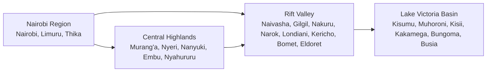
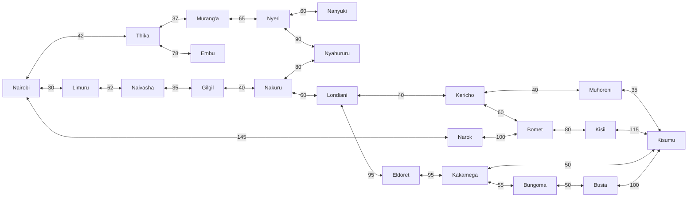
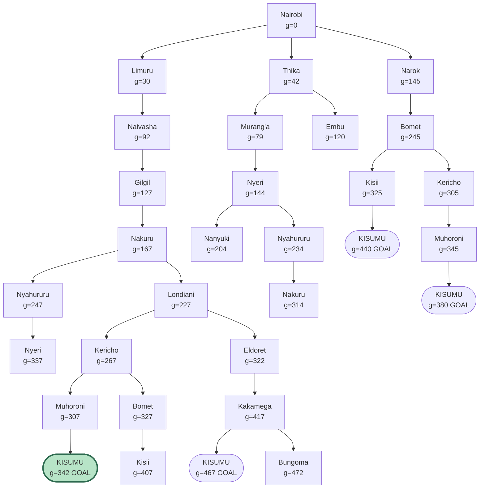

# PS-Agents: Finding the Shortest Route for a Trailer from Nairobi to Kisumu

**Group members:** (Salim Hatibu.Peter Atonga(169614).Nicole Momanyi(168320))

---

## 1. Designing the Agent

### 1.1 The problem
A trailer has to carry goods from Nairobi to Kisumu using Kenya's highways. Along the way it passes through the Nairobi region, the Central Highlands, the Rift Valley and the Lake Victoria Basin. The agent is the system that decides which towns the trailer goes through and then drives it there. We want the trip to be as short as possible.

### 1.2 PEAS

| Part | In our trailer problem |
|---|---|
| Performance measure | The main thing is the total distance from Nairobi to Kisumu, so shorter is better. Travel time, fuel, safety of the driver and cargo, and arriving on time also count. |
| Environment | The highways and towns between Nairobi and Kisumu. Other vehicles and pedestrians, weather, potholes and roadworks, steep parts like the escarpment, weighbridges and police checks. |
| Actuators | Steering, accelerator, brakes, gearbox, indicators and lights, and a screen or voice prompt telling the driver where to go. |
| Sensors | GPS, cameras and radar, speedometer, odometer, fuel gauge, engine and tyre sensors, and a live feed of traffic and road closures. |

We treat this as a goal-based agent. It knows its goal which is Kisumu, it has a map of the roads, and it searches for the moves that reach the goal at the lowest cost.

### 1.3 Environment properties

We looked at the environment in two ways. On the map the agent is only planning a route. On the road it is actually driving.

| Property | Map level (planning) | Road level (driving) | Reason |
|---|---|---|---|
| Observable | Fully observable | Partially observable | The map shows every town and distance. On the road the agent cannot see around a bend or know what other drivers will do. |
| Agents | Single agent | Multi-agent | A route plan does not depend on anyone else. Driving does, because of other vehicles, pedestrians and traffic police. |
| Deterministic | Deterministic | Stochastic | In our model, going from Gilgil to Nakuru always puts us in Nakuru. In real life, traffic, weather or a breakdown can change that. |
| Episodic or sequential | Sequential | Sequential | Each town we pick affects the next choice and the final cost. |
| Static or dynamic | Static | Dynamic | The map does not change while we plan, but traffic and weather change while the trailer moves. |
| Discrete or continuous | Discrete | Continuous | The towns and roads are a fixed, countable set. Speed, steering angle and position can take any value. |
| Known or unknown | Known | Mostly known | The agent knows which towns connect and how far apart they are, but not every local road condition. |

For the search part of this exercise, the environment is fully observable, single-agent, deterministic, sequential, static, discrete and known. Graph search works well for that.

---

## 2. The Graph and the Search Tree

### 2.1 Abstraction

A real journey has too much detail to plan with: thousands of bends, junctions, lanes and speed changes. So we used abstraction, meaning we kept only what matters for choosing a route and dropped the rest.

| Real-world detail | What we did with it |
|---|---|
| Exact GPS position, lane and speed | Dropped. The state is just the town the trailer is in. |
| Steering, braking and gear changes | Dropped. One action is "drive along the highway to the next town". |
| Traffic, weather, road quality and hills | Dropped. We assumed they are the same on every road. |
| All the bends and junctions between two towns | Combined into one edge with one cost, the driving distance in km. |
| Small towns off the main highways | Left out. We only kept the major towns on the main routes. |

We used three levels of abstraction:

1. **The real world:** continuous positions and driving actions.
2. **The town graph:** towns as nodes and highways as edges with distances. This is where we do the search.
3. **The regions:** the Nairobi region, Central Highlands, Rift Valley and Lake Victoria Basin as four big nodes. This shows the overall trip, from the Nairobi region through the Rift Valley to the Lake Victoria Basin.

### 2.2 Problem formulation

- **States:** the towns on the graph
- **Initial state:** Nairobi
- **Goal test:** is the trailer in Kisumu?
- **Actions:** drive from a town to a neighbouring town
- **Result of an action:** the trailer is now in that neighbouring town
- **Path cost:** the total of the road distances in km

### 2.3 Directed graph

Highways can be driven both ways, so each road is drawn as two arrows, one in each direction, with the same distance. The numbers on the edges are distances in km.

### 2.4 Distances

We got the driving distance between each pair of neighbouring towns from the Google Maps directions feature.

| From | To | Distance (km) |
|---|---|---|
| Nairobi | Limuru | 30 |
| Nairobi | Thika | 42 |
| Nairobi | Narok | 145 |
| Limuru | Naivasha | 62 |
| Thika | Murang'a | 37 |
| Thika | Embu | 78 |
| Murang'a | Nyeri | 65 |
| Nyeri | Nanyuki | 60 |
| Nyeri | Nyahururu | 90 |
| Naivasha | Gilgil | 35 |
| Gilgil | Nakuru | 40 |
| Nakuru | Nyahururu | 80 |
| Nakuru | Londiani | 60 |
| Londiani | Kericho | 40 |
| Londiani | Eldoret | 95 |
| Kericho | Muhoroni | 40 |
| Kericho | Bomet | 60 |
| Muhoroni | Kisumu | 35 |
| Narok | Bomet | 100 |
| Bomet | Kisii | 80 |
| Kisii | Kisumu | 115 |
| Eldoret | Kakamega | 95 |
| Kakamega | Kisumu | 50 |
| Kakamega | Bungoma | 55 |
| Bungoma | Busia | 50 |
| Busia | Kisumu | 100 |

### 2.5 Search tree

The root of the tree is Nairobi. Under each town we listed the towns the trailer can go to next, and we did not let a branch return to a town it had already passed, so there are no loops. The number next to each town is g(n), the distance travelled from Nairobi to reach it. Nodes marked GOAL are where the trailer reaches Kisumu, and we stop growing the tree there.

Abstraction shows up in the tree too. Each branch is a whole stretch of highway, and each node only means "the trailer is in this town". Nanyuki and Embu don't lead anywhere useful for reaching Kisumu, so we left them as leaves.

The tree gave four ways to reach Kisumu:

| Route | Total (km) |
|---|---|
| Nairobi, Limuru, Naivasha, Gilgil, Nakuru, Londiani, Kericho, Muhoroni, Kisumu | 342 |
| Nairobi, Narok, Bomet, Kericho, Muhoroni, Kisumu | 380 |
| Nairobi, Narok, Bomet, Kisii, Kisumu | 440 |
| Nairobi, Limuru, Naivasha, Gilgil, Nakuru, Londiani, Eldoret, Kakamega, Kisumu | 467 |

---

## 3. Finding the Best Route

### 3.1 Method

The cost is distance, so we used uniform-cost search, which works like Dijkstra's algorithm. It keeps a list of towns it can reach (the frontier) and always picks the one with the smallest distance so far. When Kisumu becomes the cheapest town on that list, no shorter route can exist, so the path to it is the best one.

### 3.2 Working

| Step | Town expanded | Distance so far (km) | What we found |
|---|---|---|---|
| 1 | Nairobi | 0 | Limuru 30, Thika 42, Narok 145 |
| 2 | Limuru | 30 | Naivasha 92 |
| 3 | Thika | 42 | Murang'a 79, Embu 120 |
| 4 | Murang'a | 79 | Nyeri 144 |
| 5 | Naivasha | 92 | Gilgil 127 |
| 6 | Embu | 120 | Dead end |
| 7 | Gilgil | 127 | Nakuru 167 |
| 8 | Nyeri | 144 | Nanyuki 204, Nyahururu 234 |
| 9 | Narok | 145 | Bomet 245 |
| 10 | Nakuru | 167 | Londiani 227. Going to Nyahururu from here would cost 247, so we keep 234. |
| 11 | Nanyuki | 204 | Dead end |
| 12 | Londiani | 227 | Kericho 267, Eldoret 322 |
| 13 | Nyahururu | 234 | Nothing new |
| 14 | Bomet | 245 | Kisii 325. Going to Kericho from here would cost 305, so we keep 267. |
| 15 | Kericho | 267 | Muhoroni 307 |
| 16 | Muhoroni | 307 | Kisumu 342 |
| 17 | Eldoret | 322 | Kakamega 417 |
| 18 | Kisii | 325 | Going to Kisumu from here would cost 440, so we keep 342. |
| 19 | Kisumu | 342 | Goal reached, so we stop. |

### 3.3 Result

The best route is:

**Nairobi → Limuru → Naivasha → Gilgil → Nakuru → Londiani → Kericho → Muhoroni → Kisumu**

| Leg | Distance (km) | Running total (km) |
|---|---|---|
| Nairobi to Limuru | 30 | 30 |
| Limuru to Naivasha | 62 | 92 |
| Naivasha to Gilgil | 35 | 127 |
| Gilgil to Nakuru | 40 | 167 |
| Nakuru to Londiani | 60 | 227 |
| Londiani to Kericho | 40 | 267 |
| Kericho to Muhoroni | 40 | 307 |
| Muhoroni to Kisumu | 35 | 342 |

**The optimal path cost is 342 km.**

### 3.4 Why this is the best route
- Uniform-cost search always finds the cheapest path when all distances are positive, and our graph is small enough for it to finish quickly.
- The second best route, through Narok, Bomet and Kericho, is 380 km. That is 38 km longer.
- Reaching Nakuru through Thika, Murang'a and Nyeri costs 314 km, compared with 167 km on the direct road, so the Central Highlands detour is not worth it.
- Our 342 km is close to the roughly 340 km Google Maps gives for Nairobi to Kisumu, so the numbers look sensible.

---

## 4. Evidence of Group Work

### 4.1Meeting minutes

**Date and time:** (15/10/2026,5:30pm )
**Where:** (Student Centre,Strathmore University)
**Present:** (Nicole Momanyi.Peter Atonga.Salim Hatibu)

**What we discussed:**
- (Which towns to put on the graph)
- (How to apply abstraction)
- (Who would check which distances on Google Maps)

**Tasks and who did them:**

| Task | Member | Deadline |
|---|---|---|
| PEAS and environment properties | (Nicole) | (15/10/2026) |
| Graph and search tree | (Salim) | (15/10/2026) |
| Checking distances on Google Maps | (Peter) | (15/10/2026) |
| Uniform-cost search working | (Peter/Salim) | (15/10/2026) |
| Final review and GitHub upload | (Nicole) | (15/10/2026) |
