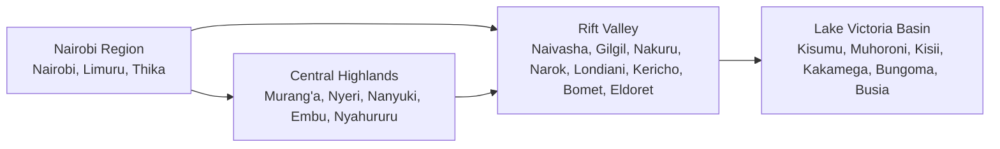
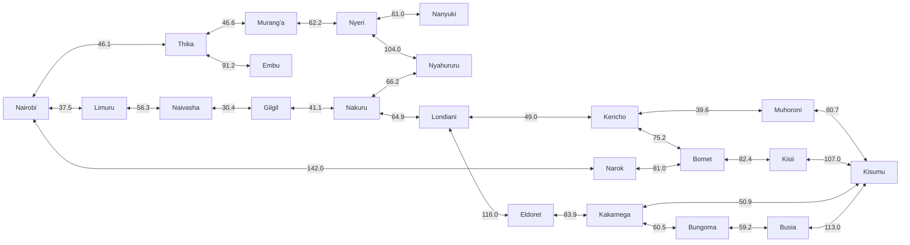
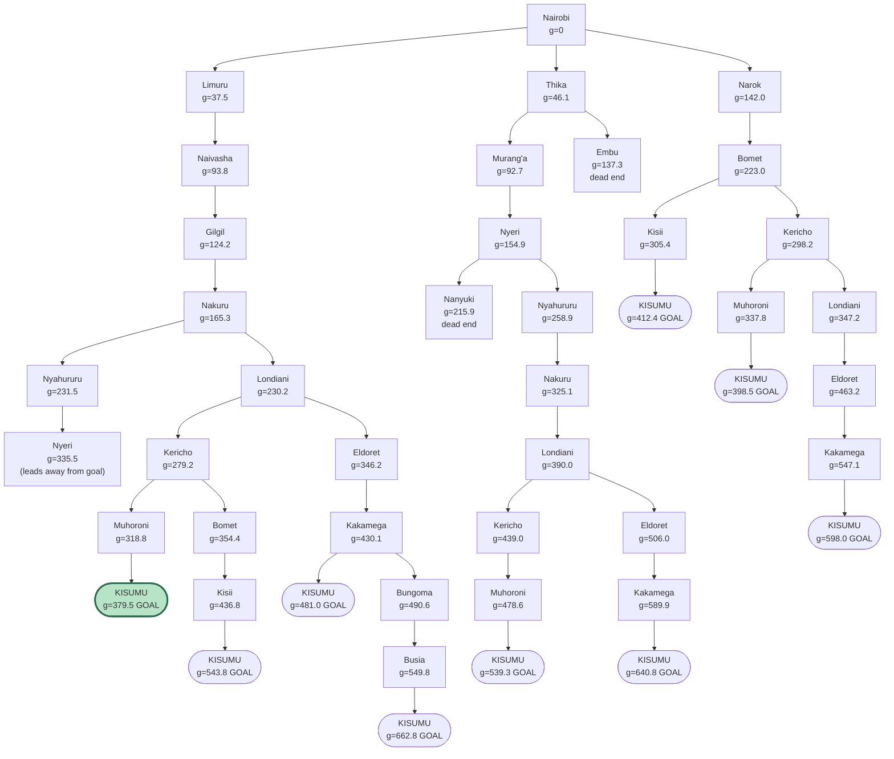

# PS-Agents: Finding the Shortest Route for a Trailer from Nairobi to Kisumu

**Group members:** Salim Hatibu (190000), Peter Atonga (169614), Nicole Momanyi (168320)


## 1. Designing the Agent

### 1.1 The problem
A trailer has to carry goods from Nairobi to Kisumu using Kenya's highways. Along the way it passes through the Nairobi region, the Central Highlands, the Rift Valley, and the Lake Victoria Basin. The agent is the system that decides which towns the trailer goes through and then drives it there. We want the trip to be as short as possible.

### 1.2 PEAS

| Part | In our trailer problem |
|---|---|
| **Performance measure** | Mainly the total distance from Nairobi to Kisumu (shorter is better). Travel time, fuel, safety of the driver and cargo, and arriving on time also count. |
| **Environment** | The highways and towns between Nairobi and Kisumu; other vehicles and pedestrians, weather, potholes and roadworks, steep sections like the escarpment, weighbridges, and police checks. |
| **Actuators** | Steering, accelerator, brakes, gearbox, indicators and lights, and a screen or voice prompt telling the driver where to go. |
| **Sensors** | GPS, cameras and radar, speedometer, odometer, fuel gauge, engine and tyre sensors, and a live feed of traffic and road closures. |

We treat this as a **goal-based agent**: it knows its goal (Kisumu), it has a map of the roads, and it searches for the sequence of moves that reaches the goal at the lowest cost.

### 1.3 Environment properties
We looked at the environment at two levels: on the map the agent is only planning a route; on the road it is actually driving.

| Property | Map level (planning) | Road level (driving) | Reason |
|---|---|---|---|
| Observable | Fully observable | Partially observable | The map shows every town and distance. On the road the agent cannot see around a bend or know what other drivers will do. |
| Agents | Single agent | Multi-agent | A route plan does not depend on anyone else. Driving does: other vehicles, pedestrians, traffic police. |
| Deterministic | Deterministic | Stochastic | In our model, driving from Gilgil to Nakuru always ends in Nakuru. In real life traffic, weather, or a breakdown can change that. |
| Episodic / sequential | Sequential | Sequential | Each town we pick affects the next choice and the final cost. |
| Static / dynamic | Static | Dynamic | The map does not change while we plan, but traffic and weather change while the trailer moves. |
| Discrete / continuous | Discrete | Continuous | Towns and roads are a fixed, countable set. Speed, steering angle, and position can take any value. |
| Known / unknown | Known | Mostly known | The agent knows which towns connect and how far apart they are, but not every local road condition. |

For the search part of this exercise the environment is **fully observable, single-agent, deterministic, sequential, static, discrete, and known**, so graph search is a good fit.

## 2. The Graph and the Search Tree

### 2.1 Abstraction
A real journey has too much detail to plan with: thousands of bends, junctions, lanes, and speed changes. We used **abstraction**, keeping only what matters for choosing a route.

| Real-world detail | What we did with it |
|---|---|
| Exact GPS position, lane, and speed | Dropped. The state is just the town the trailer is in. |
| Steering, braking, and gear changes | Dropped. One action is "drive along the highway to the next town". |
| Traffic, weather, road quality, and hills | Dropped. Assumed the same on every road. |
| All bends and junctions between two towns | Combined into one edge with one cost: the driving distance in km. |
| Small towns off the main highways | Left out. Only major towns on the main routes are kept. |

We used three levels of abstraction:
1. **The real world** – continuous positions and driving actions.
2. **The town graph** – towns as nodes, highways as edges weighted by distance. This is where we search.
3. **The regions** – Nairobi region, Central Highlands, Rift Valley, and Lake Victoria Basin as four large nodes, showing the overall trip.



### 2.2 Problem formulation
- **States:** the towns on the graph
- **Initial state:** Nairobi
- **Goal test:** is the trailer in Kisumu?
- **Actions:** drive from a town to a neighbouring town
- **Transition model (result):** the trailer is now in that neighbouring town
- **Path cost:** the sum of the road distances in km

### 2.3 Directed graph
Highways can be driven both ways, so each road is two arcs, one in each direction, with the same distance (shown as a double arrow).



### 2.4 Distances
The cell below stores the corrected distances and builds the graph used by the search. It also prints the distance table.

```python
edges = [
    ("Nairobi", "Limuru", 37.5),   ("Nairobi", "Thika", 46.1),     ("Nairobi", "Narok", 142.0),
    ("Limuru", "Naivasha", 56.3),  ("Thika", "Murang'a", 46.6),    ("Thika", "Embu", 91.2),
    ("Murang'a", "Nyeri", 62.2),   ("Nyeri", "Nanyuki", 61.0),     ("Nyeri", "Nyahururu", 104.0),
    ("Naivasha", "Gilgil", 30.4),  ("Gilgil", "Nakuru", 41.1),     ("Nakuru", "Nyahururu", 66.2),
    ("Nakuru", "Londiani", 64.9),  ("Londiani", "Kericho", 49.0),  ("Londiani", "Eldoret", 116.0),
    ("Kericho", "Muhoroni", 39.6), ("Kericho", "Bomet", 75.2),     ("Muhoroni", "Kisumu", 60.7),
    ("Narok", "Bomet", 81.0),      ("Bomet", "Kisii", 82.4),       ("Kisii", "Kisumu", 107.0),
    ("Eldoret", "Kakamega", 83.9), ("Kakamega", "Kisumu", 50.9),   ("Kakamega", "Bungoma", 60.5),
    ("Bungoma", "Busia", 59.2),    ("Busia", "Kisumu", 113.0),
]

# Undirected road network: every road becomes two directed arcs with the same cost
graph = {}
for a, b, d in edges:
    graph.setdefault(a, {})[b] = d
    graph.setdefault(b, {})[a] = d

print(f"{'From':<10} {'To':<10} {'Distance (km)':>13}")
print("-" * 35)
for a, b, d in edges:
    print(f"{a:<10} {b:<10} {d:>13.1f}")
print(f"\n{len(graph)} towns, {len(edges)} roads ({2*len(edges)} directed arcs)")
```

**Output:**

```text
From       To         Distance (km)
-----------------------------------
Nairobi    Limuru              37.5
Nairobi    Thika               46.1
Nairobi    Narok              142.0
Limuru     Naivasha            56.3
Thika      Murang'a            46.6
Thika      Embu                91.2
Murang'a   Nyeri               62.2
Nyeri      Nanyuki             61.0
Nyeri      Nyahururu          104.0
Naivasha   Gilgil              30.4
Gilgil     Nakuru              41.1
Nakuru     Nyahururu           66.2
Nakuru     Londiani            64.9
Londiani   Kericho             49.0
Londiani   Eldoret            116.0
Kericho    Muhoroni            39.6
Kericho    Bomet               75.2
Muhoroni   Kisumu              60.7
Narok      Bomet               81.0
Bomet      Kisii               82.4
Kisii      Kisumu             107.0
Eldoret    Kakamega            83.9
Kakamega   Kisumu              50.9
Kakamega   Bungoma             60.5
Bungoma    Busia               59.2
Busia      Kisumu             113.0

22 towns, 26 roads (52 directed arcs)
```

### 2.5 Search tree
The root is Nairobi. Under each town we list the towns the trailer can drive to next, without revisiting a town already on that path (no loops). The number on each node is $g(n)$, the cumulative distance from Nairobi. Rounded nodes are goal nodes (Kisumu); the optimal one is highlighted. Branches that only lead to dead ends or very long detours are shortened.



The code below lists **every** loop-free route from Nairobi to Kisumu on this graph, so the tree can be checked.

```python
def all_routes(node, goal, path, cost, found):
    """Depth-first enumeration of every loop-free path from node to goal."""
    if node == goal:
        found.append((round(cost, 1), path))
        return
    for nxt, d in graph[node].items():
        if nxt not in path:
            all_routes(nxt, goal, path + [nxt], cost + d, found)

routes = []
all_routes("Nairobi", "Kisumu", ["Nairobi"], 0.0, routes)
routes.sort()

print(f"{len(routes)} loop-free routes from Nairobi to Kisumu:\n")
for i, (cost, path) in enumerate(routes, 1):
    print(f"{i:>2}. {cost:6.1f} km  {' -> '.join(path)}")
```

**Output:**

```text
12 loop-free routes from Nairobi to Kisumu:

 1.  379.5 km  Nairobi -> Limuru -> Naivasha -> Gilgil -> Nakuru -> Londiani -> Kericho -> Muhoroni -> Kisumu
 2.  398.5 km  Nairobi -> Narok -> Bomet -> Kericho -> Muhoroni -> Kisumu
 3.  412.4 km  Nairobi -> Narok -> Bomet -> Kisii -> Kisumu
 4.  481.0 km  Nairobi -> Limuru -> Naivasha -> Gilgil -> Nakuru -> Londiani -> Eldoret -> Kakamega -> Kisumu
 5.  539.3 km  Nairobi -> Thika -> Murang'a -> Nyeri -> Nyahururu -> Nakuru -> Londiani -> Kericho -> Muhoroni -> Kisumu
 6.  543.8 km  Nairobi -> Limuru -> Naivasha -> Gilgil -> Nakuru -> Londiani -> Kericho -> Bomet -> Kisii -> Kisumu
 7.  598.0 km  Nairobi -> Narok -> Bomet -> Kericho -> Londiani -> Eldoret -> Kakamega -> Kisumu
 8.  640.8 km  Nairobi -> Thika -> Murang'a -> Nyeri -> Nyahururu -> Nakuru -> Londiani -> Eldoret -> Kakamega -> Kisumu
 9.  662.8 km  Nairobi -> Limuru -> Naivasha -> Gilgil -> Nakuru -> Londiani -> Eldoret -> Kakamega -> Bungoma -> Busia -> Kisumu
10.  703.6 km  Nairobi -> Thika -> Murang'a -> Nyeri -> Nyahururu -> Nakuru -> Londiani -> Kericho -> Bomet -> Kisii -> Kisumu
11.  779.8 km  Nairobi -> Narok -> Bomet -> Kericho -> Londiani -> Eldoret -> Kakamega -> Bungoma -> Busia -> Kisumu
12.  822.6 km  Nairobi -> Thika -> Murang'a -> Nyeri -> Nyahururu -> Nakuru -> Londiani -> Eldoret -> Kakamega -> Bungoma -> Busia -> Kisumu
```

The four main routes are:

| Route | Total distance (km) |
|---|---|
| Nairobi → Limuru → Naivasha → Gilgil → Nakuru → Londiani → Kericho → Muhoroni → Kisumu | **379.5** |
| Nairobi → Narok → Bomet → Kericho → Muhoroni → Kisumu | 398.5 |
| Nairobi → Narok → Bomet → Kisii → Kisumu | 412.4 |
| Nairobi → Limuru → Naivasha → Gilgil → Nakuru → Londiani → Eldoret → Kakamega → Kisumu | 481.0 |

All other routes are longer (539.3 km and above), mainly because they go through the Central Highlands (Thika → Murang'a → Nyeri → Nyahururu) or through Bungoma and Busia.

## 3. Finding the Best Route

### 3.1 Method
We use **uniform-cost search (UCS)**, the graph-search form of Dijkstra's algorithm. The frontier is a priority queue ordered by $g(n)$, the path cost from Nairobi. At each step the node with the lowest $g(n)$ is removed and expanded. If a cheaper path to a town already on the frontier is found, it replaces the old one. A town is added to the explored set once it is expanded and is never expanded again. The search stops when **Kisumu is removed from the frontier** (not when it is first generated), which is what guarantees the path is optimal, since all road costs are positive.

```python
import heapq

def uniform_cost_search(start, goal):
    frontier = [(0.0, start, [start])]          # (g, town, path)
    best_g = {start: 0.0}                       # cheapest known g for each town
    explored = set()
    step = 0
    print(f"{'Step':<5}{'Expanded':<11}{'g(n)':>7}   Frontier updates")
    print("-" * 80)
    while frontier:
        g, town, path = heapq.heappop(frontier)
        if town in explored or g > best_g[town]:
            continue                            # stale queue entry, skip it
        step += 1
        if town == goal:
            print(f"{step:<5}{town:<11}{g:>7.1f}   Goal removed from frontier, stop")
            return path, g
        explored.add(town)
        notes = []
        for nxt, d in graph[town].items():
            new_g = round(g + d, 1)
            if nxt in explored:
                continue
            if new_g < best_g.get(nxt, float("inf")):
                old = best_g.get(nxt)
                best_g[nxt] = new_g
                heapq.heappush(frontier, (new_g, nxt, path + [nxt]))
                notes.append(f"{nxt} {new_g}" + (f" (replaces {old})" if old is not None else ""))
            else:
                notes.append(f"{nxt} {new_g} (worse than {best_g[nxt]}, ignored)")
        print(f"{step:<5}{town:<11}{g:>7.1f}   {', '.join(notes) if notes else 'Dead end (all neighbours explored)'}")
    return None, float("inf")

best_path, best_cost = uniform_cost_search("Nairobi", "Kisumu")
print("\nOptimal path:", " -> ".join(best_path))
print(f"Optimal path cost: {best_cost:.1f} km")
```

**Output:**

```text
Step Expanded      g(n)   Frontier updates
--------------------------------------------------------------------------------
1    Nairobi        0.0   Limuru 37.5, Thika 46.1, Narok 142.0
2    Limuru        37.5   Naivasha 93.8
3    Thika         46.1   Murang'a 92.7, Embu 137.3
4    Murang'a      92.7   Nyeri 154.9
5    Naivasha      93.8   Gilgil 124.2
6    Gilgil       124.2   Nakuru 165.3
7    Embu         137.3   Dead end (all neighbours explored)
8    Narok        142.0   Bomet 223.0
9    Nyeri        154.9   Nanyuki 215.9, Nyahururu 258.9
10   Nakuru       165.3   Nyahururu 231.5 (replaces 258.9), Londiani 230.2
11   Nanyuki      215.9   Dead end (all neighbours explored)
12   Bomet        223.0   Kericho 298.2, Kisii 305.4
13   Londiani     230.2   Kericho 279.2 (replaces 298.2), Eldoret 346.2
14   Nyahururu    231.5   Dead end (all neighbours explored)
15   Kericho      279.2   Muhoroni 318.8
16   Kisii        305.4   Kisumu 412.4
17   Muhoroni     318.8   Kisumu 379.5 (replaces 412.4)
18   Eldoret      346.2   Kakamega 430.1
19   Kisumu       379.5   Goal removed from frontier, stop

Optimal path: Nairobi -> Limuru -> Naivasha -> Gilgil -> Nakuru -> Londiani -> Kericho -> Muhoroni -> Kisumu
Optimal path cost: 379.5 km
```

### 3.2 Working
The trace above, written out as a table:

| Step | Town expanded | $g(n)$ | What we found / frontier update |
|---|---|---|---|
| 1 | Nairobi | 0.0 | Limuru 37.5, Thika 46.1, Narok 142.0 |
| 2 | Limuru | 37.5 | Naivasha 93.8 |
| 3 | Thika | 46.1 | Murang'a 92.7, Embu 137.3 |
| 4 | Murang'a | 92.7 | Nyeri 154.9 |
| 5 | Naivasha | 93.8 | Gilgil 124.2 |
| 6 | Gilgil | 124.2 | Nakuru 165.3 |
| 7 | Embu | 137.3 | Dead end |
| 8 | Narok | 142.0 | Bomet 223.0 |
| 9 | Nyeri | 154.9 | Nanyuki 215.9, Nyahururu 258.9 |
| 10 | Nakuru | 165.3 | Londiani 230.2, Nyahururu 231.5 (replaces 258.9) |
| 11 | Nanyuki | 215.9 | Dead end |
| 12 | Bomet | 223.0 | Kericho 298.2, Kisii 305.4 |
| 13 | Londiani | 230.2 | Kericho 279.2 (replaces 298.2), Eldoret 346.2 |
| 14 | Nyahururu | 231.5 | Dead end (Nyeri and Nakuru already explored) |
| 15 | Kericho | 279.2 | Muhoroni 318.8 (Bomet already explored) |
| 16 | Kisii | 305.4 | Kisumu 412.4 |
| 17 | Muhoroni | 318.8 | Kisumu 379.5 (replaces 412.4) |
| 18 | Eldoret | 346.2 | Kakamega 430.1 |
| 19 | Kisumu | 379.5 | Goal removed from frontier, stop |

When the search stops, Kakamega (430.1) is still on the frontier. It is never expanded because it already costs more than 379.5 km.

### 3.3 Result
**Optimal path:** Nairobi → Limuru → Naivasha → Gilgil → Nakuru → Londiani → Kericho → Muhoroni → Kisumu

| Leg | Distance (km) | Running total (km) |
|---|---|---|
| Nairobi to Limuru | 37.5 | 37.5 |
| Limuru to Naivasha | 56.3 | 93.8 |
| Naivasha to Gilgil | 30.4 | 124.2 |
| Gilgil to Nakuru | 41.1 | 165.3 |
| Nakuru to Londiani | 64.9 | 230.2 |
| Londiani to Kericho | 49.0 | 279.2 |
| Kericho to Muhoroni | 39.6 | 318.8 |
| Muhoroni to Kisumu | 60.7 | 379.5 |

**Optimal path cost: 379.5 km**

```python
# Check the result leg by leg against the distance table
running = 0.0
for a, b in zip(best_path, best_path[1:]):
    running += graph[a][b]
    print(f"{a:<9} -> {b:<9} {graph[a][b]:6.1f} km   total {running:6.1f} km")
assert round(running, 1) == round(best_cost, 1) == routes[0][0]
print("\nUCS result matches the shortest of all enumerated routes.")
```

**Output:**

```text
Nairobi   -> Limuru      37.5 km   total   37.5 km
Limuru    -> Naivasha    56.3 km   total   93.8 km
Naivasha  -> Gilgil      30.4 km   total  124.2 km
Gilgil    -> Nakuru      41.1 km   total  165.3 km
Nakuru    -> Londiani    64.9 km   total  230.2 km
Londiani  -> Kericho     49.0 km   total  279.2 km
Kericho   -> Muhoroni    39.6 km   total  318.8 km
Muhoroni  -> Kisumu      60.7 km   total  379.5 km

UCS result matches the shortest of all enumerated routes.
```

### 3.4 Analysis
- Uniform-cost search found the minimum-cost route, **379.5 km**, and this matches the shortest of all 12 loop-free routes enumerated in Section 2.5.
- The southern route through Narok, Bomet, and Kericho is 398.5 km, about **19 km longer**. UCS first reached Kericho through Bomet (298.2 km) but then found the cheaper path through Londiani (279.2 km) and replaced it.
- The route through Kisii (412.4 km) was the first path to Kisumu that UCS generated, but it was replaced when the Muhoroni path (379.5 km) was found. This shows why UCS only stops when the goal is *removed* from the frontier: stopping when it was first generated would have given a wrong answer.
- Going through the Central Highlands (Thika → Murang'a → Nyeri → Nyahururu) adds a lot of distance; the best route that way is 539.3 km, so it is not a good choice for trailer freight.
- The northern route through Eldoret and Kakamega (481.0 km) is about 101 km longer than the optimal route.
- UCS expanded 19 nodes. Embu, Nanyuki, and Nyahururu were expanded even though they lead nowhere useful, because UCS has no idea which direction Kisumu is in. An informed search such as A* with a straight-line-distance heuristic would avoid most of these.

## 4. Evidence of Group Work

### 4.1 Meeting minutes
**Date and time:** 15/10/2026, 5:30 PM  
**Where:** Student Centre, Strathmore University  
**Present:** Nicole Momanyi, Peter Atonga, Salim Hatibu

**What we discussed:**
- Re-verifying road segments and updating distances with precise Google Maps data.
- Updating the search tree weights and recalculating the uniform-cost search steps.
- Finalising the documentation and repository structure.

**Tasks and who did them:**

| Task | Member | Deadline |
|---|---|---|
| PEAS and environment properties review | Nicole | 15/10/2026 |
| Graph adjustments and Mermaid tree updates | Salim | 15/10/2026 |
| Re-checking distances on Google Maps | Peter | 15/10/2026 |
| Uniform-cost search recalculations | Peter / Salim | 15/10/2026 |
| Final review and formatting | Nicole | 15/10/2026 |
